# 🍄 Concept: Super Mario Clone - C++ & WinBGIm

Acest document prezintă conceptul și arhitectura planificată pentru un viitor joc de tip platformer 2D, inspirat de clasicul Super Mario. Proiectul urmează să fie dezvoltat în C++ folosind biblioteca grafică WinBGIm.

## Viziunea Generală și Mecanici Principale

Scopul proiectului este crearea unui motor fizic de bază și a unui sistem de redare pe un grid de tip tilemap. Jocul va integra următoarele mecanici esențiale:

* **Sistem de Cameră (Side-Scrolling):** Ecranul va urmări mișcarea jucătorului pe axa X, calculând relativ coordonatele de desenare pentru a crea iluzia de deplasare prin nivel.
* **Fizică și Gravitație:** Personajul principal va fi afectat constant de gravitație. Săriturile vor fi simulate prin aplicarea unei viteze negative pe axa Y, care va fi redusă progresiv în timp real.
* **Sistem de Coliziuni:** Verificarea coliziunilor se va realiza prin scanarea marginilor personajului (bounding box) în raport cu matricea hărții, pentru a bloca trecerea prin elementele solide.
* **Optimizare Grafică:** Pentru a preveni efectul de flickering (pâlpâire), grafica va fi desenată într-un buffer ascuns (Double Buffering), iar tranziția pe ecran se va face instantaneu. Texturile vor fi preîncărcate în memoria RAM pentru performanță.
* **Interfață (HUD):** Va exista un afișaj în timp real pentru Nivel, Scor și numărul de vieți rămase.

* * 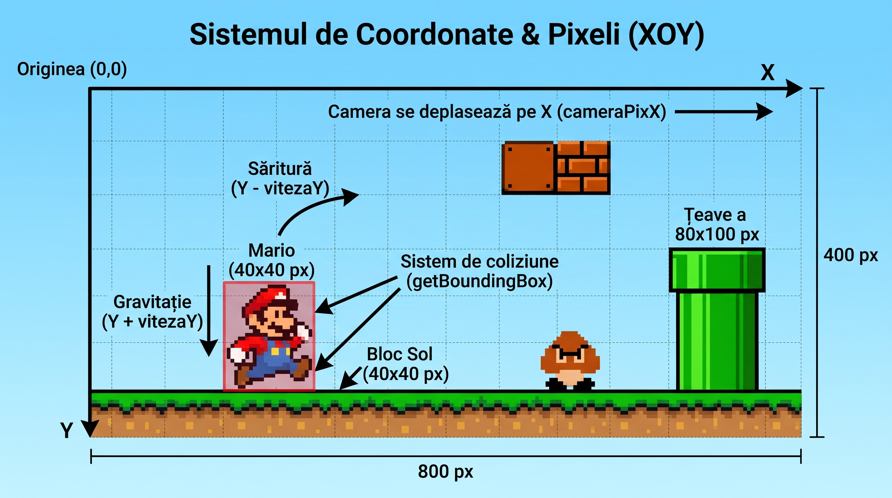

## Arhitectura Hărții (Tilemap)

Nivelurile vor fi generate pe baza unei matrici de caractere. Fiecare caracter va reprezenta un bloc de dimensiune standard (ex: 40x40 pixeli). Harta este conceptualizată prin următoarele tipuri de elemente:

EX: Harta v a fi impartita in 3 pentru o consistenta mai buna adica:

-> In loc sa facem o matrice mare cu toate blocurile, cu toate texturile vom lua acea matrice mare si o vom sparge in 3: -> 

const char cer[3][LUNGIME_HARTA + 1] = {

"............................................................",

".......n.........................n..........................",

"......nnn.......................nnn........................."

};

char mijloc[5][LUNGIME_HARTA + 1] = {

"............................................................",

".........................................................s..",

"............S..bbb.................................Bii......",

"......................bb............ti.............iii......",

"................g...................ii........g.P..iii.....b"

};

const char jos[2][LUNGIME_HARTA + 1] = {

"pppppppppppppppppppppppppppppppppppppppppppppppppppppppppppp",

"pppppppppppppppppppppppppppppppppppppppppppppppppppppppppppp"

};

### Blocuri Solide (Coliziune Activă)
Acestea sunt elementele prin care jucătorul și inamicii nu vor putea trece:
* `p` - **Pământ / Sol:** Platforma principală pe care se vor deplasa entitățile.d
* 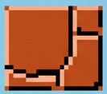
* `b` - **Cărămidă:** Bloc solid de decor, cu potențialul de a fi distrus de jucător prin sărituri de dedesubt.
* * 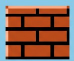
* `S` - **Bloc Secret / Întrebare:** Bloc solid interactiv din care jucătorul va putea obține puncte sau power-up-uri (monede, ciuperci care ii vor da viteza lui mario).
* * 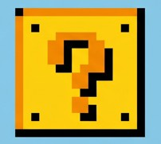
* `t` - **Țeavă:** Obstacol vertical clasic (cu posibilitatea viitoare de a fi folosit pentru transport către hărți subterane).
* * 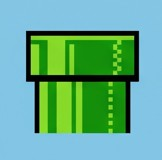
* `i` - **Bloc Invizibil:** Bariere invizibile folosite pentru a delimita harta sau pentru a ghida jucătorul fără a încărca ecranul vizual.
* 

### Decor și Spațiu (Fără Coliziune)
* `.` - **Aer (Spațiu liber):** Permite trecerea și căderea liberă a tuturor entităților.
* `n` - **Nor:** Element pur vizual de fundal.
* * 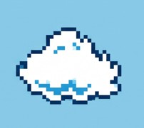
* `s` - **Steag:** Element de progresie care va marca finalul nivelului.
* * 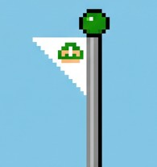

## Entități și Personaje Planificate

Jocul va conține o listă de entități dinamice și statice, fiecare cu propriul set de reguli de comportament:

### Personajul Controlabil (protagonistul)
* **Mario:** Va fi controlat de jucător și va putea să meargă, să sară și să interacționeze cu elementele hărții. Obiectivul său este să ajungă la steagul de final evitând pericolele.
* * 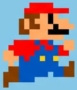

### Inamici
* `g` - **Goomba:** Inamicul de bază. Acesta va avea o mișcare autonomă pe axa orizontală și va schimba direcția la impactul cu blocurile solide. Jucătorul îl va putea elimina printr-o coliziune superioară (săritură pe el) sau va pierde o viață în cazul unei coliziuni laterale.
* * 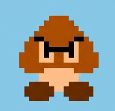
* `B` - **Bowser (Boss):** Antagonistul principal. Conceptual, acesta va necesita o mecanică avansată de inteligență artificială, incluzând capacitatea de a sări pentru a bloca drumul și de a lansa atacuri de la distanță (ex: flăcări).
* * 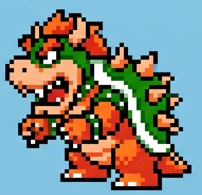

### Personaje Non-Jucător (NPC)
* `P` - **Prințesa Peach:** Obiectivul narativ al jocului, va fi poziționată strategic la finalul aventurii.
* * 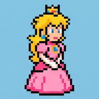

## Obiective Tehnice Viitoare

Pe lângă funcțiile de bază, planul de dezvoltare include:
* Sistem Audio:** Integrarea efectelor sonore specifice (săritură, interacțiune cu inamicii, game over) și a muzicii de fundal folosind API-ul Windows.
* Gestiunea Nivelurilor:** Crearea unui sistem care să permită tranziția fluidă între hărți și sub-niveluri diferite, gestionând corect punctajul și starea personajului între scene.
*Tevile verzi: ** Posibilitatea ca Mario sa poata calatori prin tevi apasarea butonului "s" sau sageata in jos.
* Animatii mai fluide si mai frumoase** (Mario cu personalitate, bauzar desenat altfel) poate un framerate mai bun
* Sistem de finalitate** ex. cand atinge steagul sa se termine nivelul si sa inceapa altul
